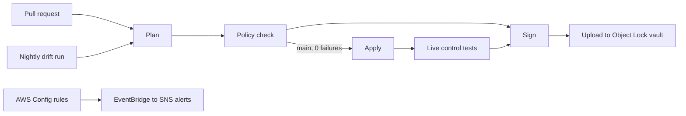

# Acme Health Patient Intake API: HIPAA GRC capstone

A fork of `cgep-app-starter` made audit-defensible under the **HIPAA Security Rule**. Every push to `main` is planned, checked against five HIPAA Rego policies, applied only if the gate passes, tested live, and recorded as a signed evidence bundle in an Object Lock vault. Between deploys, AWS Config and EventBridge watch the live account and a nightly run checks for drift. Reasoning is in [WRITEUP.md](WRITEUP.md), the control matrix in [CONTROLS.md](CONTROLS.md), and the decision record in [DECISIONS.md](DECISIONS.md).



## At a glance

| | |
|---|---|
| Primary framework | HIPAA Security Rule; OSCAL catalog source NIST SP 800-66 Rev. 2 |
| Gaps closed (Terraform + policy) | GAP-01, 02, 03, 04, 07 |
| Gaps open | GAP-05, 06, 08 (approach in WRITEUP.md) |
| Policies | 5 Rego policies, 26 unit tests |
| Live tests | 11, after every apply and nightly |
| Continuous monitoring | 8 AWS Config rules; alerts on non-compliance and out-of-band changes |
| Green PR | [#1](https://github.com/SeraphimO120/cgep-app-starter/pull/1), passed and merged |
| Red PR | [#2](https://github.com/SeraphimO120/cgep-app-starter/pull/2), reintroduces `dynamodb:*`, blocked by GAP-07 policy |
| Verified runs | 38051692529 on `main` (`CHAIN INTACT`); 38072307218 drift run (no drift, 11/11 live tests) |

## Layout

| Path | Contents |
|---|---|
| `terraform/` | Starter workload plus `grc_baseline.tf` (KMS, gap fixes), `grc_evidence.tf` (vault, CloudTrail), `grc_pipeline.tf` (OIDC roles), `grc_monitoring.tf` (Config, EventBridge, SNS), `backend.tf` |
| `policies/` | Five HIPAA Rego policies and their tests |
| `.github/workflows/grc-gate.yml` | Plan, Policy check, Apply, Sign, Upload; nightly drift and live tests |
| `oscal/` | Component definition and profile |
| `scripts/verify-evidence.sh` | SHA-256, Cosign, and Object Lock checks for one run |
| `scripts/control-tests.sh` | 11 live control tests against the deployed stack |

Tools: Terraform 1.16.5, OPA 1.21, Conftest 0.71.0, Cosign v3.1.3, compliance-trestle 5.1.0.

## Verify

**1. Policies.**

```bash
opa test policies -v
```

**2. Evidence without AWS access.** Each run publishes its bundle, hash, signature bundle, and receipt as a GitHub Actions artifact (90-day retention). Requires `gh` (logged in) and Cosign.

```bash
RUN=38051692529
gh run download $RUN --repo SeraphimO120/cgep-app-starter -n grc-evidence-$RUN
sha256sum evidence-$RUN-*.tar.gz && cat evidence-$RUN-*.tar.gz.sha256
cosign verify-blob \
  --bundle evidence-$RUN-*.tar.gz.sigstore.json \
  --certificate-identity-regexp '^https://github\.com/SeraphimO120(@[0-9]+)?/cgep-app-starter(@[0-9]+)?/\.github/workflows/grc-gate\.yml@refs/.+$' \
  --certificate-oidc-issuer https://token.actions.githubusercontent.com \
  evidence-$RUN-*.tar.gz
cat receipt.json
```

The two hashes match, Cosign prints `Verified OK`, and `receipt.json` records the vault version ID and Object Lock retain-until date captured at upload.

**3. Evidence in the vault.** Requires read access to the AWS account.

```bash
scripts/verify-evidence.sh 38051692529
```

Prints `CHAIN INTACT` when the hash matches, the signature verifies against this repo's workflow identity, and Object Lock retention is active.

**4. Live controls.** Requires AWS read access and `jq`; run from the repo root after `terraform -chdir=terraform init`.

```bash
scripts/control-tests.sh
aws configservice describe-compliance-by-config-rule \
  --query 'ComplianceByConfigRules[].[ConfigRuleName,Compliance.ComplianceType]' --output table
```

Without AWS access, the same results are in `evidence/control-tests.json` inside any `main`, nightly, or manual run's artifact.

**5. OSCAL.** Trestle validates inside a workspace:

```bash
mkdir -p .trestle-work && cd .trestle-work && trestle init
mkdir -p component-definitions/acme-health-intake profiles/hipaa-capstone
cp ../oscal/components/acme-health-intake.json component-definitions/acme-health-intake/component-definition.json
cp ../oscal/profiles/hipaa-capstone.json profiles/hipaa-capstone/profile.json
trestle validate -f component-definitions/acme-health-intake/component-definition.json
trestle validate -f profiles/hipaa-capstone/profile.json
```
